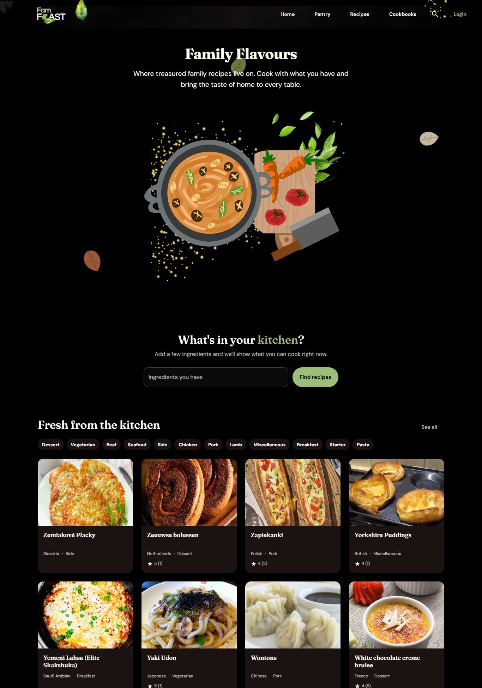
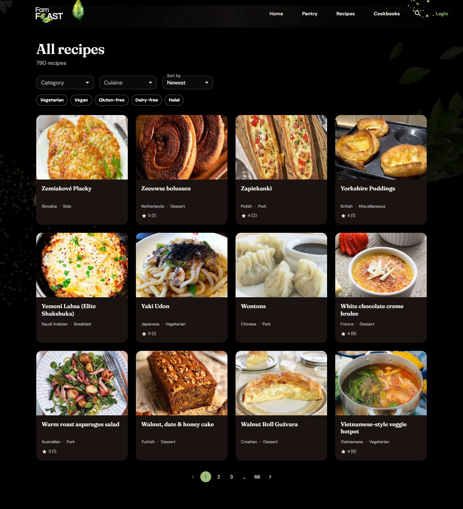

# FamFeast

**Cook what you have. Share what you love.**

FamFeast is a recipe site built around two ideas that most recipe sites skip:

1. **"What can I cook?"** Type the ingredients in your kitchen and get recipes ranked by how much of each you already own, with what's missing and a swap suggestion for it.
2. **Family cookbooks.** Private, invite-only recipe collections for your household, so grandma's biryani lives somewhere safer than a WhatsApp thread.

Live demo: [fam-feast-frontend.vercel.app](https://fam-feast-frontend.vercel.app/) (still the previous version until the new one is deployed, see [Deploying](#deploying))





> The screenshots show the development database: 790 starter recipes from TheMealDB plus **sample** members, ratings and comments that are generated by `npm run seed:community` and are not real people.

---

## Features

| Area | What you get |
|---|---|
| **Pantry matcher** | Add ingredients (autocomplete, paste a list, or free text). Results show a % match, what you're missing, and ingredient swaps. Filters: allowed missing items, diet, scope (public / my cookbooks / saved). Your pantry is remembered. |
| **Family cookbooks** | Create a cookbook, share an 8-character invite code, add family-only recipes (with an optional story), optionally also publish a recipe publicly. Owners manage members and codes. Private recipes are invisible to everyone else, including in search and the pantry matcher. |
| **Recipes** | Browse and filter by category, cuisine, diet and sort order. Recipe pages have a hero image, tick-off ingredients and steps, ratings, save, share, print, comments with replies, and "more like this". Structured data (`schema.org/Recipe`) is added for Google. |
| **Accounts** | Sign up / log in, profiles with follower and following lists, saved recipes, edit and delete your own content. |
| **Optional AI (Gemini)** | Scan a fridge photo into an ingredient list, import a recipe from a photo of a handwritten card, parse messy text like "2 tomatos n some chicken", suggest substitutes. Off unless `GEMINI_API_KEY` is set. |
| **Resilience** | Skeleton loaders on every page, clear error states with a *Try again* button when the server is down or slow, and a friendly crash screen instead of a blank page. |

### Public vs private pages

| Public | Needs an account |
|---|---|
| Home, recipe catalogue, recipe pages, pantry matcher (public recipes), profiles, login / sign up | Add / edit recipes, comment, rate, save, follow, family cookbooks, saved recipes, pantry search of your cookbooks, AI tools |

---

## Tech stack

- **Frontend:** React 18, React Router 6, Material UI 5 (custom dark theme), Axios. Fonts: Fraunces (headings) and DM Sans (text) via Google Fonts; the logo wordmark uses Questrial and Blaka.
- **Backend:** Node 24, Express 4, Mongoose / MongoDB Atlas, JWT auth, bcrypt, Helmet, express-rate-limit, compression, Multer.
- **Integrations:** ImgBB (recipe photo uploads), Google Gemini (optional AI), TheMealDB (starter recipes).
- **Tests:** Jest + Supertest (50 API tests).

---

## Repository structure

```
famFeast/
├── public/                    static files, favicon, app icons, brand/ (logo SVGs)
├── src/                       React app
│   ├── index.js               routes (public + protected), theme and providers
│   ├── theme.js               colours and typography (Fraunces + DM Sans)
│   ├── api.js                 Axios instance, token handling, error messages
│   ├── config.js              reads REACT_APP_API_URL
│   ├── auth/AuthContext.js    login state, session check
│   ├── pages/                 Home, Browse, RecipeDetail, RecipeForm, Pantry,
│   │                          Cookbooks, CookbookDetail, Profile, Saved, AuthPage, NotFound
│   ├── components/            Header/ (navbar + hero), Layout, Backdrop, RecipeCard, RecipeGrid,
│   │                          Comments, IngredientInput, Skeletons, ErrorState, RouteError, ...
│   └── utils/images.js        picks the right TheMealDB image size
├── backend/
│   ├── index.js               entry point (also the Vercel entry)
│   ├── src/
│   │   ├── app.js             Express app: security middleware, routes, error handler
│   │   ├── database/          connectivity + models and routes: User, Recipe (+ ratings),
│   │   │                      Comment, Cookbook
│   │   ├── routes/            pantry.js (matcher, autocomplete), ai.js (Gemini endpoints)
│   │   ├── middleware/        auth.js (JWT), security.js (sanitising, rate limits)
│   │   ├── utils/             ingredients.js (normalise + match), cache, gemini, image upload
│   │   └── data/              substitutions.js (curated ingredient swaps)
│   ├── scripts/               seed, seed-community, backup, reindex-ingredients
│   └── tests/api.test.js      API test suite
└── docs/screenshots/          images used in this README
```

---

## Running it locally

Requirements: **Node 24** and a MongoDB Atlas (or local MongoDB) connection string.

```bash
git clone https://github.com/zhtHreem/famFeast.git
cd famFeast

# 1. Backend
cd backend
npm install
cp .env.example .env        # then fill it in, see the table below
npm run seed                # loads ~790 starter recipes
npm start                   # http://localhost:5000

# 2. Frontend (new terminal, from the project root)
cd ..
npm install
cp .env.example .env        # REACT_APP_API_URL=http://localhost:5000/api
npm start                   # http://localhost:3000 (or the next free port)
```

> Use a **separate database for development** (`MONGO_DB_NAME=FamFest_dev` in `backend/.env`) so seeding never touches live data.

### Environment variables

**`backend/.env`**

| Variable | Required | Purpose |
|---|---|---|
| `MONGO_URI` | yes | MongoDB connection string |
| `JWT_SECRET` | yes | Signs login tokens. Generate: `node -e "console.log(require('crypto').randomBytes(48).toString('hex'))"` |
| `CORS_ORIGINS` | production | Comma-separated frontend origins allowed to call the API (any `localhost` port is allowed in development) |
| `MONGO_DB_NAME` | optional | Use a different database than the one in the URI |
| `IMGBB_API_KEY` | for photo upload | Free key from api.imgbb.com |
| `GEMINI_API_KEY`, `GEMINI_MODEL` | for AI features | Free key from aistudio.google.com; the model name can be changed if Google renames it |
| `DNS_SERVERS` | optional | e.g. `8.8.8.8,1.1.1.1` if your network blocks `mongodb+srv` lookups |
| `PORT`, `JWT_EXPIRES_IN` | optional | Defaults: 5000 and 7d |

**`.env` (frontend):** `REACT_APP_API_URL`, the backend URL ending in `/api`.

### Scripts (`backend/`)

| Command | What it does |
|---|---|
| `npm test` | Runs the API tests against a separate `FamFest_test` database |
| `npm run seed` | Replaces the seeded starter recipes with a fresh copy from TheMealDB (`-- --wipe` also deletes every user-made recipe, comment and rating, so back up first) |
| `npm run backup` | Dumps every collection to `backend/backups/` as JSON (git-ignored) |
| `npm run reindex` | Recomputes ingredient keys after the matching rules change |
| `npm run seed:community` | Creates the **sample** community. Refuses to run on the live database. `-- --remove` deletes it again |

---

## How it works

### The pantry matcher

1. Every ingredient is **normalised** into a key (`"2 large Eggs"` → `egg`, `"Cilantro"` → `coriander`, `"Egg Plants"` → `eggplant`) by stripping amounts, units and descriptors, singularising and mapping synonyms.
2. A pantry item can **satisfy** a recipe key only by safe rules: exact match, same head noun (`red onion` ↔ `onion`) or a cut/part (`chicken` ↔ `chicken wing`, `lemon` ↔ `lemon juice`). Words that change what something is (`coconut milk`, `almond flour`, `peanut butter`) never match the plain version. This is covered by tests.
3. The pantry is expanded into every recipe key it can satisfy, and **MongoDB scores the recipes in one aggregation** (indexed on the ingredient keys), returning only the top results. Salt, pepper, water and oil are optionally assumed.

### Performance

- Compound indexes that match the real query and sort patterns; list queries use `lean()` and tight projections.
- 30-second server cache for public lists, 5-minute cache for filter options, gzip compression, and `Cache-Control` headers.
- Recipe images are requested at the right size (`/small`, `/medium`, `/large`), about a quarter of the original weight.
- Measured against Atlas: pantry search 1.2–2.7 s → about 0.3 s; cached list responses a few milliseconds and about 1 KB gzipped.

### Security

- Passwords hashed with bcrypt; login uses one generic error for unknown email and wrong password.
- JWT auth. **Every write checks ownership** on the server (edit or delete only your own recipes, comments and account).
- Private cookbook recipes return 404 to non-members, so their existence isn't revealed.
- Request sanitising against NoSQL operator injection, regex escaping in search, body size limit, Helmet headers, rate limits (stricter on login and AI), strict CORS in production, upload type and size limits.
- Secrets live in environment files that are git-ignored. `.env` used to be committed in this repo, so **rotate any credential that was ever pushed.**

### Resilience

Loading, empty and error states exist on every page (skeletons, a *Try again* button, and a route-level error boundary). It was tested with the API down, returning 500s, responding slowly, and returning malformed data.

---

## Deploying

The frontend and backend deploy as two Vercel projects (`backend/vercel.json` is included). Both are pinned to Node 24 in `package.json`.

1. Set the backend environment variables above, plus `CORS_ORIGINS=https://your-frontend-domain`.
2. Set `REACT_APP_API_URL=https://your-backend-domain/api` on the frontend project.
3. **Migrate the live database before switching traffic.** The old site stored recipes in a different shape:
   ```bash
   cd backend
   npm run backup           # keep a copy first
   npm run seed -- --wipe   # replaces recipes, comments and ratings (users are kept)
   npm run reindex
   ```
4. Existing users keep working (their password hashes are unchanged) but must log in again.

---

## What we did not do (yet)

Being upfront about the gaps:

- **Not deployed, and the live database has not been migrated.** All work was verified locally against a development database.
- **Gemini features are untested against the real API** (no key was available). Without a key they stay hidden and everything else works. The default model name may need updating.
- **The sample community is fake.** Members, ratings and comments from `seed:community` exist to make development feel alive. Remove them before real users arrive and never present them as genuine reviews.
- **Starter recipes come from TheMealDB's free development key.** Check their terms (a supporter key) before a public launch. Seeded recipes have no prep/cook time or difficulty because the source doesn't provide them, and their descriptions are generated from the data.
- **Accounts are basic:** no email verification, password reset, social login or refresh tokens. The JWT is kept in `localStorage`, which is simple but exposed to XSS; httpOnly cookies would be stronger.
- **No moderation tools:** no reporting, admin panel or image moderation.
- **Search is simple regex search**, fine for about a thousand recipes. Atlas Search or text indexes would be better at scale.
- **Caches and rate limits are per server instance**, so on serverless hosting they reset on cold starts. A shared store (e.g. Redis) would fix that.
- **Frontend has no automated tests** (only the API has). The browser flows were checked with scripted Playwright runs that are not committed.
- **Create React App is deprecated.** Migrating to Vite is the sensible next step.
- **SEO:** the app is a single-page app. Recipe structured data is added in the browser, and there is no sitemap or server-side rendering yet.
- **Not built:** servings scaling, nutrition, meal planner and shopping list, notifications, a followed-users feed, and translations (the old Urdu header text was replaced with English).

## Roadmap ideas

Shopping list from missing ingredients, weekly meal planner, scale servings, cook mode (big text, screen stays on), "cooked it" photos from the community, email verification and password reset.

---

## Credits

Starter recipes and photos: [TheMealDB](https://www.themealdb.com). Fonts: Fraunces and DM Sans (Google Fonts, OFL).
